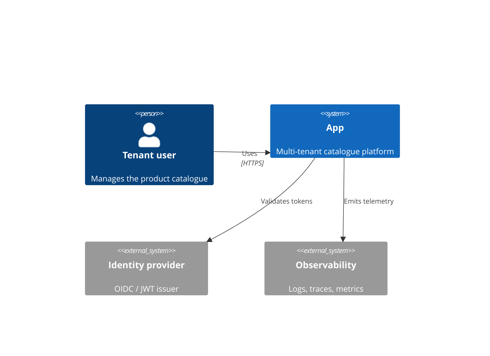
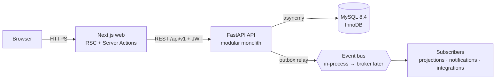
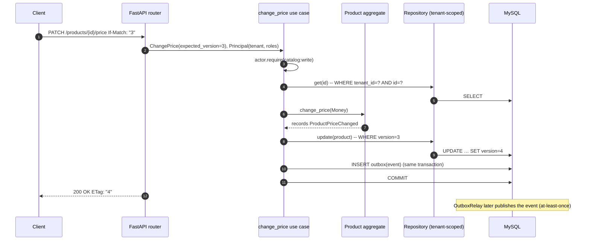

# Architecture overview

## C4 · System context

## C4 · Containers

## Request flow: change price (optimistic concurrency + outbox)

## Quality attributes and how they are met
| Attribute | Mechanism | Verified by |
|---|---|---|
| Correctness | Aggregates enforce invariants; value objects self-validate | unit tests, mutation tests |
| Tenant isolation | JWT-derived tenant → tenant-scoped repositories | cross-tenant unit + integration + API tests |
| Concurrency | Optimistic locking (version), ETag / If-Match, idempotency keys | concurrent-update integration test |
| Reliability | Transactional outbox, timeouts, graceful shutdown | outbox integration tests |
| Performance | Keyset pagination, composite indexes, pooled async I/O | k6 SLO thresholds, slow-query log |
| Security | OWASP ASVS L2 controls, Problem Details without internals, headers/CSP | Semgrep, CodeQL, ZAP, Trivy, Gitleaks |
| Evolvability | Hexagonal layers, ADRs, import contracts | `make arch` |
